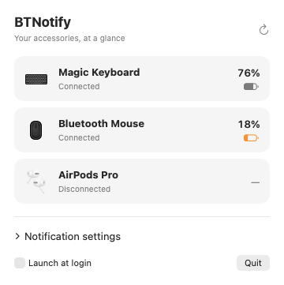

# BTNotify

See Bluetooth accessory batteries and connection status in your Mac menu bar. Receive alerts when accessories connect, disconnect, or need charging.



*The main panel uses example accessories and readings.*

## Features

- **Accessory status:** battery percentage, connection state, charging state, and device icons. Unknown battery levels remain blank.
- **Notifications:** separate controls for connection changes and low batteries. Optional reminders repeat every five minutes without stacking alerts.
- **Menu bar indicator:** a hollow dot turns system red when a known battery reaches the selected threshold.
- **Daily use:** manual refresh, automatic checks, launch at login, and a right-click menu with the version and Quit.
- **Native integration:** Swift and SwiftUI, AppleScript commands, accessibility labels, Reduce Motion support, and icons for macOS appearances.

BTNotify recognizes keyboards, mice, trackpads, headphones, headsets, AirPods, game controllers, and styluses. It excludes HomePod, Apple TV, and AirPlay receivers.

## Install

BTNotify requires **macOS 14 or later**. Builds support Apple silicon and Intel Macs. Runtime checks cover Apple silicon on macOS 27.2. Intel execution remains untested.

1. Open [Releases](https://github.com/WardsParadox/BTNotify/releases).
2. Download `BTNotify-macOS.zip` from a release. Prereleases contain builds for testing.
3. Extract `BTNotify-macOS.zip`.
4. Move `BTNotify.app` to **Applications**.
5. Open BTNotify.

The download uses an ad hoc signature and has no notarization.

The [macOS build](https://github.com/WardsParadox/BTNotify/actions/workflows/build.yml) workflow also supplies a **BTNotify-macOS** artifact. Extract its enclosed ZIP to obtain the app. Workflow artifacts expire after 14 days.

## Use the menu

Click the Bluetooth icon in the menu bar to open the main panel. Use the refresh button to check accessories immediately.

BTNotify also checks every **30 seconds** and whenever you open the panel. Very brief connection changes can escape these checks.

Open **Notification settings** to change alert preferences. Select **Allow Notifications** to request macOS permission. This button disappears after macOS grants permission.

Enable **Launch at login** beside **Quit** to launch BTNotify when you log in. The setting defaults to off unless macOS already registered BTNotify.

If macOS requires approval, select **Open Login Items**. The checkbox reflects changes from System Settings when you reopen the panel. Disabling this setting does not quit BTNotify.

Right-click or Control-click the menu bar icon to see the version and **Quit**. Keep BTNotify running to receive alerts. BTNotify does not pair or connect accessories.

### Missing accessories

BTNotify can show fewer accessories than **System Settings → Bluetooth**. It needs a recognized device type or an observed battery before it shows an accessory.

**Connect a new accessory to this Mac at least once while BTNotify runs.** Pairing alone may not supply enough information. BTNotify remembers learned input-device types across disconnections and restarts.

**AirPods are an exception.** Their iCloud pairing data can make them appear before their first connection to this Mac. An accessory can appear without a battery reading.

## Notifications

### Choose alerts

**Notifications** enables or disables alerts. **Connection changes** and **Low battery** control each alert type separately.

The low-battery threshold defaults to **20%**. Normal choices are 10%, 15%, 20%, 25%, and 30%. BTNotify suppresses low-battery alerts while an accessory reports charging.

After a low-battery alert, the battery must reach five points above the threshold before another low-battery cycle can trigger an alert. Initial connection baselines remain silent.

Alerts contain the accessory name and event, such as “Magic Keyboard battery is low”. The panel shows percentages. Alerts omit percentages.

### One alert at a time

BTNotify keeps **one outstanding notification**. Dismiss it in **Notification Center** to allow the next alert. A banner that disappears automatically still counts as outstanding.

BTNotify waits until you unlock the Mac before it sends another alert. It retains only the latest deferred event. The event must still apply to the current readings.

BTNotify requests persistent alerts by default. Your macOS notification settings control the actual presentation.

### Optional reminders

**Nag me!** defaults to off. Enable it to repeat low-battery alerts at most every **five minutes**. The accessory must remain connected, low, and not charging. The Mac must be unlocked.

Reminders replace the existing alert instead of creating a stack. With reminders disabled, dismissal alone does not trigger another alert for the same low-battery condition.

### Red indicator

The menu bar dot turns system red when a known battery reaches or falls below **Alert at**. It clears when all known low batteries rise above that threshold.

Charging does not clear the dot until the battery rises above the threshold. Notification permission, delivery, dismissal, and panel opening do not control the dot.

BTNotify retains the last known battery state during the current run. Unknown readings and disconnections do not prove that a battery recovered.

## Advanced settings

**Option-click Notification settings** to reveal advanced controls. This also works when the settings are already open.

| Control | Purpose |
| --- | --- |
| **Check time** | Check every 10 or 30 seconds, or every 1, 2, 3, 4, or 5 minutes. |
| **Alert at** | Select 10% through 90% in steps of 5 percentage points. |
| **Test notification** | Use the **Test** button to send a test alert. |
| **Permission status** | Read the current macOS notification permission. |
| **Reading source and counter** | Read the data source and time since the last update, below settings and above the footer. |

The selected check time and threshold persist across restarts. A selected threshold above 30% remains available during normal use. **Check time** does not change the five-minute reminder interval.

Source details disappear when you collapse settings. A normal settings opening hides advanced controls. Reopening the panel resets advanced mode.

## AppleScript

BTNotify supports Apple Events through its scripting dictionary. Run this example in Script Editor:

```applescript
tell application "BTNotify"
    launch
    accessory status
end tell
```

`accessory status` returns the latest cached readings. Each record contains `id`, `name`, `connected`, `battery level`, `charging`, and `device type`. An unknown battery returns `missing value`.

Use `refresh accessories` to check immediately and return updated readings. Refresh follows the normal notification rules. Neither command changes preferences or opens the panel.

Use `tell application "BTNotify" to quit` to stop BTNotify. Read the dictionary through **File → Open Dictionary** in Script Editor.

## Accessibility and limitations

Each accessory row exposes its name, connection, charging state, and battery as one spoken element. Controls expose spoken names and relevant hints. The title is a heading.

The panel resizes with its content and scrolls long accessory lists. Expansion and collapse respect **Reduce Motion**. The Quit button has a visible outline. Control–Option activation preserves ordinary VoiceOver behavior.

Live VoiceOver navigation and larger text remain incompletely verified.

Battery readings depend on a private macOS power-source API. macOS updates may change its behavior. BTNotify reports read errors and does not estimate missing percentages.

Exact parity with the macOS battery widget remains unverified. Live AirPods component battery coverage also remains unverified.

## Build from source

Use Xcode with Swift 6 support. Open [BTNotify.xcodeproj](BTNotify.xcodeproj), select the **BTNotify** scheme, and press **⌘R**.

To build without opening the app:

```sh
xcodebuild -project BTNotify.xcodeproj -scheme BTNotify \
  -configuration Debug -derivedDataPath .build/xcode build
```

The app appears at `.build/xcode/Build/Products/Debug/BTNotify.app`. A local shortcut also exposes `.build/debug/BTNotify.app`.

Both Debug and Release produce universal Apple silicon/Intel apps from the Xcode project settings. The app runtime uses Swift and does not run subprocesses.

### Developer checks

Install [mise](https://mise.jdx.dev/) before configuring the tools and Git hooks:

```sh
mise install
mise run hooks:install
mise run secrets:check
mise run secrets:history
```

The hooks use the official [awslabs/git-secrets](https://github.com/awslabs/git-secrets) through mise and hk. They check staged files, commit messages, and file history before a push.

See [PLAN.md](PLAN.md) for design decisions, build details, and verification commands. See the [security review](research/SECURITY-REVIEW.md) for audit scope and results.

The [investigation](research/INVESTIGATION.md) records the battery research. The [draft API report](research/BATTERY-API-BUG-DRAFT.md) remains unsubmitted. Incorrect Bluetooth percentages remain unreproduced.
